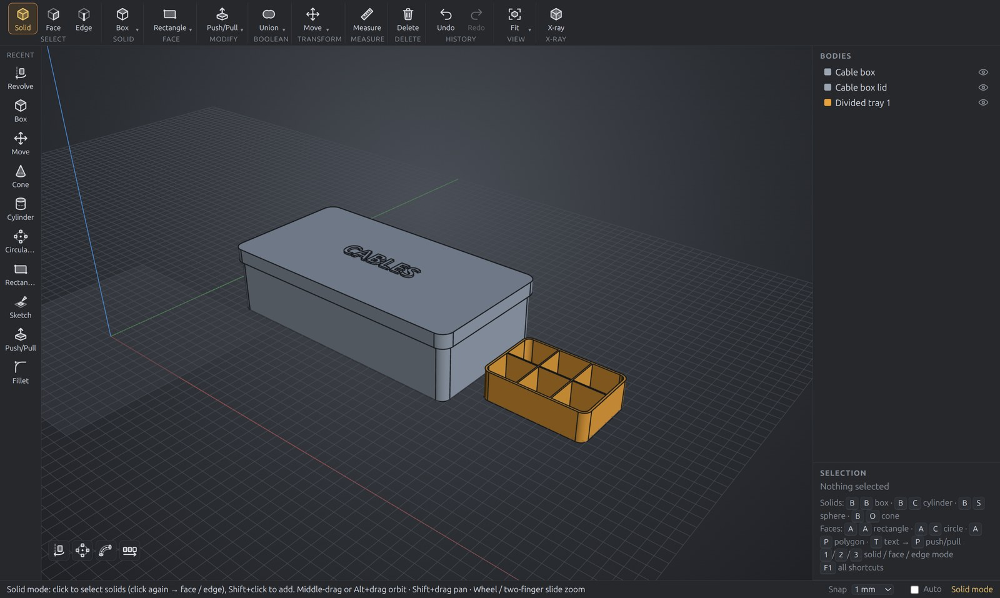

# YDDD: easy 3D CAD for 3D printing, on Linux and Windows

**Draw a shape, push and pull it, type exact sizes, export 3MF for your slicer.**
No history tree, no constraint solver, nothing to set up first.



## Download

**[Download YDDD](https://github.com/canoon-gmail/yddd/releases/latest)**, then:

- **Windows** (`YDDD-*-x64.zip`): right-click it → **Extract All**, open the folder and double-click
  **YDDD.exe**. Nothing to install. Windows may say "Windows protected your PC" the first time
  (YDDD isn't signed yet): click **More info → Run anyway**.
- **Linux** (`YDDD-*.deb`): `sudo apt install ./YDDD-*.deb` (Ubuntu, Debian, Mint, Pop!_OS).

macOS is coming. [Tell us if you want it](https://github.com/canoon-gmail/yddd/issues/new?template=feature_request.yml).

## Your first print in 3 minutes

1. Open YDDD and choose **Help → Cable Storage Box**.
2. Press **Do all** to watch it build the box, the lid and the label. Or follow the steps yourself.
3. Choose **File → Export 3MF** and open the file in Bambu Studio, PrusaSlicer or Cura.

There are more walkthroughs in the Help menu: Planter, Bird House, House, Propeller.
Press **F1** for all the shortcuts.

## What it's good at

- **Boxes and enclosures**: *Box from Face* turns any outline into an open box with walls and a
  floor. *Box Lid* adds a lid with a lip or a cap, with the print clearance built in. *Dividers*
  splits a box into equal compartments.
- **Fit for printing**: click a hole or pin and type a new diameter, or "0.2 mm bigger all
  round". Fillet, chamfer, shell.
- **Text**: raised or cut letters on any flat face, in any installed font (Thai too).
- **Exact geometry**: an OpenCascade B-rep kernel underneath. Export STEP, STL or 3MF (one
  closed, named object per body).

## Tell us what you think

YDDD is new, and first impressions are the most useful thing you can give us.
**[Share your first impressions](https://github.com/canoon-gmail/yddd/issues/new?template=first_impressions.yml)**:
what you tried to make, where you got stuck, and whether you'd use it again.
Found a bug? [Report it](https://github.com/canoon-gmail/yddd/issues/new?template=bug_report.yml) and attach the
`.yddd` file if you can.

## Features (v0.1)

| Area | What you can do |
|---|---|
| Solids | Box, Cylinder, Sphere drawn interactively on the grid **or on any planar face**, grid snapping (Ctrl = free), typed exact dimensions |
| Faces | Rectangle, Circle, Polygon (3–64 sides) create **flat faces**; **Push/Pull** a flat face to extrude it into a new solid |
| Text | **T** (or **A T**): click where it starts on the ground or a flat face (upright on a wall), type it in the panel — font (built in: Noto Sans / Serif / Sans Thai, Regular and Bold — on Linux and Windows also any installed TTF / OTF font; Thai letters work in any of them), height (a capital letter, mm), alignment, letter spacing, more lines (Shift+Enter); Enter adds a flat face per letter as one group, **P** pushes them all into raised letters; **S** scales text evenly only (it keeps its shape); the pencil by a text group in the Bodies panel edits it again — wherever it was moved / turned / scaled, flat or pushed |
| Sketch | **K**: draw lines, tangent arcs, rectangles and circles on a flat face or the ground in a flat view (3D preview in the corner); select outlines to move them (**G**) or scale / rotate them with one gizmo (**S**: squares and yellow ring scale, blue ring rotates); Done turns the closed outlines into flat faces (with holes) and open lines (ended with Enter / double-click) into **paths** |
| Select | Solid / Face / Edge modes with hover highlight, Shift+click multi-select |
| Colour | Click a body's swatch in the Bodies panel: colour (presets or any) and opacity (10–100 %); several selected → all of them. A group's swatch colours its members that have no colour of their own — if some do, YDDD asks whether to apply it to all members. Saved in the file, undoable |
| Modify | Push/Pull face (flat face → new solid; solid face → modify, or tick *New solid*), Fillet & Chamfer (selected edges or whole solid), Shell (open selected faces) — all with live preview |
| Revolve / Sweep | **Revolve** (Modify menu; Pro: **R E**) a flat face about a guide line, one of its edges or X / Y / Z (any angle; a circle beside the axis → a donut) · **Sweep** (Pro: **S W**) a flat face along a path or guide line — a flat ring makes a tube; pick the face and path in the viewport while the panel is open |
| Macro | **Box from Face**: a flat face (any outline) is the inside of an open-top box — type Wall (grows outward), Bottom (grows down) and the inside depth; optionally round vertical edges · **Box Lid** (Inside Lip / Over the Box): a lid for an open-top box, closed on it — a lip in the opening or a cap over it, with a clearance · **Dividers**: walls in an open-top box — columns × rows of equal compartments, the walls following the inside (round corners, a round cup) and optionally lower than the rim (room for a lid's lip), fused into the box |
| Holes | **Resize hole / pin**: Edge mode, click a round hole's (or pin's) rim, **S**, type the diameter — or how much bigger for several of different sizes (a looser fit for 3D printing); any other hole — rectangle, slot, a sketched shape — one rim edge + **S**: *Bigger by* mm, all round · **Del** with rims selected fills the holes (any shape) / takes off the pins |
| Boolean | Union, Subtract, Intersect (first selected solid is the target) |
| Transform | Move / Rotate gizmo (snaps to grid / 5°), Duplicate, **Mirror** (**M**: click a ±X / ±Y / ±Z mark — a mirrored copy beyond that side, touching it; *Join* makes a solid and its copy one, e.g. a half dome → a ball), Delete |
| History | Unlimited-ish undo / redo (200 steps) |
| Files | Save/Open native `.yddd` (exact BREP), **Open Recent** (last 10, Ctrl+Shift+1…9), Import STEP, Export STEP / STL / **3MF** (for slicers: Bambu Studio, PrusaSlicer, Cura — one named object per body, closed meshes, mm) |

Press **F1** in the app for all shortcuts, or **/** to search every operation, run it, and change its key (a key, two keys one after the other, or mouse side button 4 / 5 — checked against keys already in use; ↺ puts a default back).

## Mouse
 
* **Middle-drag** or **Alt + Left-drag**: orbit
* **Shift + Left-drag** or **Shift / Ctrl + Middle-drag**: pan
* **Wheel**: zoom to cursor
* **Left click**: select / draw / use tool
* **Snapping**: tools snap to corners, midpoints, centres, edges, guides, axes and the grid by themselves —
  hold **Ctrl** to place freely. Untick **Auto** (status bar, by Snap) to snap only while Ctrl is held.

## Development

YDDD is a direct-modeling B-rep modeller built with **Electron + TypeScript**, **Three.js** for the viewport and
**OpenCascade** (via [replicad](https://replicad.xyz) / WebAssembly) as the geometry kernel. Units are millimetres,
Z is up.

```bash
npm install
npm start        # type-check, build and launch
npm run dev      # Vite dev server with hot reload + Electron
npm run dist     # build the .deb in release/
npm run dist:win # build the Windows zip in release/ (works on Linux, no Wine)
npm run smoke    # automated end-to-end test, screenshots in /tmp/yddd-smoke
npm run smoke:half  # the same without scenarios 1–3 (about half the time)
npm run start:stress          # launch with 2000 test solids (N=5000 npm run start:stress for more)
```

## Code layout

```
src/main/main.ts        Electron main: app:// protocol (serves wasm), menu, file dialogs
src/main/preload.ts     Safe IPC bridge (window.yddd)
src/main/smoke.ts       Opt-in E2E test (YDDD_SMOKE=<dir>)
src/renderer/kernel.ts  The only module that talks to OpenCascade/replicad
src/renderer/kernel.worker.ts  A second OpenCascade in a Web Worker for slow ops (Fillet / Chamfer, Shell, heavy booleans, STEP import, STEP / STL / 3MF export), results meshed there too: the app stays live, Esc / Stop ends them
src/renderer/kernelWorker.ts   The app's end of it (jobs → promises, cancel = end the worker and start a fresh one)
src/renderer/document.ts Immutable body snapshots + undo/redo
src/renderer/viewport.ts Three.js scene, tessellation display, picking, gizmo
src/renderer/tools.ts   Interactive Box/Cylinder/Sphere drawing tools
src/renderer/main.ts    App controller: commands, selection, op panel, UI
```

Face and edge ids are the OpenCascade shape hash codes, which link the
tessellated triangles/lines back to the exact B-rep topology for fillets,
push/pull and so on.

## License notes

YDDD is MIT (`LICENSE`). OpenCascade (replicad-opencascadejs, `vendor/occt`) is LGPL-2.1; replicad and
Three.js are MIT; the Noto fonts are SIL OFL 1.1 — see `THIRD_PARTY_NOTICES.md` and `licenses/`.

## TODO

- [ ] **Pre-build snap points ahead of time.** Snap points are built lazily on the first
  snap query (~100 ms hitch at 5000 solids, `npm run bench`). Build them in idle time
  after `Viewport.sync()` (e.g. `requestIdleCallback`, in chunks) so complex models
  respond instantly on the first hover.
